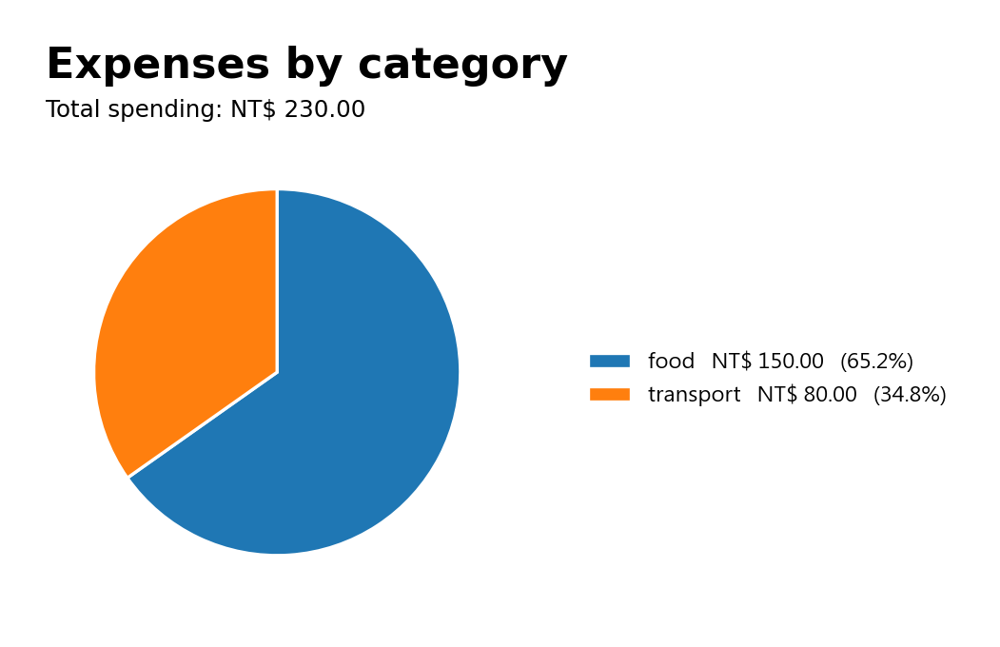

# Expense Tracker

A Python expense tracking application developed for Introduction to Software Engineering - Assignment 1.

This project supports expense entry, CSV storage, and category-based pie chart visualization.

## Team Members

| Member | Responsibility | Git Branch |
|---|---|---|
| Member A | Expense Input and CSV Storage | feature-input |
| Member B | Expense Visualization | feature-piechart |

## Features

- Add multiple expenses with date, amount, category, and optional notes.
- Validate date and amount inputs.
- Save expense records to expenses.csv.
- Handle missing line breaks when appending CSV records.
- Calculate total spending by category.
- Generate a pie chart showing category percentages.
- Automatically regenerate the pie chart after adding an expense.

## Installation

Requirements:
- Python 3
- matplotlib

Install dependencies:

```bash
python -m pip install -r requirements.txt
```

## How to Run

### 1. Add Expenses

Run:

```bash
python input_expense.py
```

The program displays:

```text
Expense Tracker
1. Add expense
2. Exit
Choose an option:
```

Select 1 to add an expense.

Example:

```text
Date (YYYY-MM-DD): 2026-11-21
Amount: 150
Category: food
Notes (optional): lunch
```

The expense is saved to expenses.csv.

After saving, the program automatically runs visualize.py to update pie_chart.png if the visualization module is available.

Select 1 to add another expense or 2 to exit.

### 2. Generate Pie Chart

The visualization module can also be executed separately:

```bash
python visualize.py
```

The program reads expenses.csv and generates pie_chart.png.

Custom input and output paths are supported:

```bash
python visualize.py expenses.csv --output pie_chart.png
```

## CSV Data Format

Expenses are stored using the following columns:

- date: Expense date (YYYY-MM-DD)
- amount: Expense amount
- category: Expense category
- notes: Optional description

Example:

```csv
date,amount,category,notes
2026-11-21,150,food,lunch
2026-11-21,80,transport,bus
```

## Sample Pie Chart



The chart displays total spending and each category's percentage of the total.

## Git Collaboration

This project uses Git and GitHub for version control and teamwork.

- Member A develops the expense input module on feature-input.
- Member B develops the visualization module on feature-piechart.
- Both branches are integrated through Git Merge.
- The GitHub Network Graph records the collaboration and merge history.

## Project Structure

```text
expense-tracker/
├── .gitignore
├── README.md
├── requirements.txt
├── input_expense.py
├── visualize.py
├── expenses.csv
└── sample_pie_chart.png
```

The application also generates pie_chart.png when the visualization module runs.
